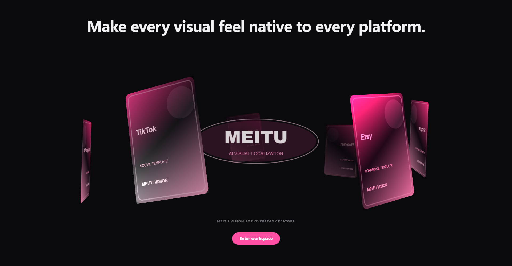
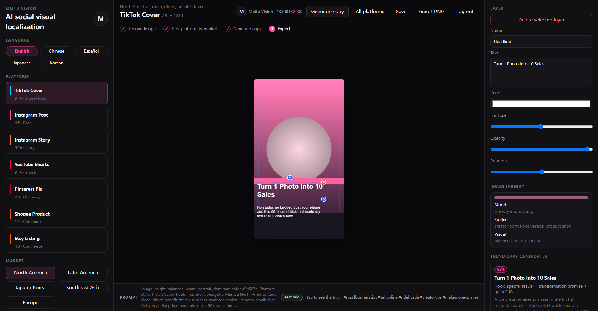
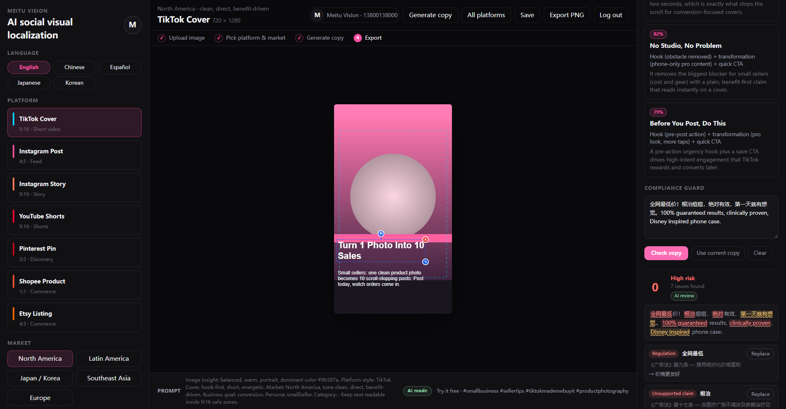

# 美图视觉

美图视觉是一个面向海外内容创作者和跨境卖家的 **AI 社媒增长工作台**。它不是图片滤镜项目，而是围绕「同一张视觉素材如何适配不同海外平台、不同市场语言、不同商业目标」来设计。上传一张图，产出平台适配的视觉草稿、市场语言的文案候选，以及发布前的合规检查。

<p align="center">
  
</p>

## 技术栈

**前端**：Vue3 · TypeScript · Vite · Pinia · Canvas 2D（图层合成、安全区、PNG 导出）· three.js（WebGL 开场场景）· vue-i18n（五语言界面）· IndexedDB（设计历史与品牌套件）· jszip（多平台批量导出）

**模型**：DeepSeek `deepseek-chat`（文案生成，JSON mode）· 智谱 `glm-4v-flash`（多模态图像理解）

<p align="center">
  
</p>

## 核心功能

**图像与画布**

- 上传图片并自动铺满当前平台画布
- 分析亮度、冷暖色、横竖图、主色与画面氛围
- 视觉安静区检测：分析图像梯度能量，文字自动避开画面主体
- 支持 TikTok、Instagram、YouTube Shorts、Pinterest、Shopee、Etsy 平台模板与平台安全区
- 文字与贴纸图层拖拽编辑，支持内容、颜色、字号、透明度、旋转
- 导出 PNG

**文案与合规**

- 商业目标、目标人群自由选择，内容品类自由填写，留空时由 AI 根据图片推断
- 接入 DeepSeek 生成多条文案候选，展示爆款评分、文案结构与推荐原因
- 双层合规检测：本地规则词库 + DeepSeek 语义审查
- 一键替换为建议表述，替换后同步画布图层并重扫

**多平台**

- 一稿多平台：同一套图层自动重排到六种平台画布比例
- 批量导出为单个 ZIP

**工作台**

- 设计记录与品牌套件存入 IndexedDB，可二次编辑
- 界面支持 简体中文 / English / Español / 日本語 / 한국어 切换
- 手机号注册与自定义头像

## AI 能力

文案由真实大模型生成，不是预置模板。

- **文本模型 DeepSeek `deepseek-chat`**：以 JSON mode（`response_format: json_object`）、`temperature: 0.8` 调用，返回的是严格 JSON 契约而非需要清洗的自由文本。
- **视觉模型 智谱 `glm-4v-flash`**：读取上传图片，输出主体 / 场景 / 氛围 / 品类 / 卖点 / SEO 关键词，作为文案生成的事实依据。
- **分层 Prompt 体系**（`src/utils/prompt.ts`）：角色设定 → 设计 brief（画布与安全区、市场语气、商业目标、人群、品类）→ 图像洞察（本地启发式分析 + 多模态视觉结果）→ 平台与市场 playbook 注入 → 严格 JSON 输出契约（3 条非同义改写、按市场定语言、headline ≤ 42 字符、caption ≤ 160 字符、自评分）。
- **完整降级**：无 key、网络异常、超时、JSON 解析失败均回退到本地规则引擎，页面不白屏，UI 显示「AI 模式 / 离线规则」徽章。
- **密钥安全**：API key 仅由 Vite dev proxy（`/llm`、`/vision`）注入请求头，不进入打包产物，也不提交进仓库。

## 违禁词合规检测

文案在离开工作台之前先过一遍合规检查。

<p align="center">
  
</p>

- **第一层 · 本地规则词库**：覆盖《广告法》绝对化用语、医疗功效、收益承诺，FTC / EU 655-2013 声称规则，日本薬機法表述，以及平台侧禁令（Etsy / Shopee IP 词、TikTok 互动作弊、站外导流）。离线运行、零延迟、无需 key。
- **第二层 · DeepSeek 语义审查**：识别词库抓不到的隐含功效、无依据对比、孤立看安全但整体在承诺结果的话术。按「文案 + 市场 + 平台」缓存。
- **误报控制**：语义命中与词库命中重叠时丢弃；上下文豁免让「第一天 / 第一次」不被判为绝对化用语。
- **一键修复**：每条命中有偏移量可高亮定位，附带替换建议，应用后重写文案、更新画布图层并重扫。
- **导出拦截**：打开多平台导出时提示剩余高风险用词数量。
- **报告导出**：可下载 TXT 合规报告。

## 密钥与安全说明

出于安全考虑，本项目的 `DEEPSEEK_API_KEY` 与 `ZHIPU_API_KEY` 均**有意不提交**到仓库。

密钥保存在本地 `.env.local`（已被 `.gitignore` 排除），请求由 Vite dev proxy 注入 `Authorization` 请求头，不出现在前端代码、打包产物或 git 历史中。

未配置密钥时：文案生成回退本地规则引擎，图像理解回退本地特征提取，合规检测保留词库层、跳过语义层 —— **页面不白屏，功能不中断**。

## 本地运行

前置要求：Node.js `^20.19.0 || >=22.12.0`（Vite 7 硬性要求）、npm 10 及以上

```bash
npm ci
cp .env.local.example .env.local   # Windows: copy .env.local.example .env.local
npm run dev
```

随后打开 http://localhost:5173。

> 修改 `.env.local` 后需重启 dev server（Vite 仅在启动时读取）。
> `/llm` 与 `/vision` 依赖 Vite 开发服务器代理，静态构建产物直接部署时 AI 能力会走离线降级路径。
